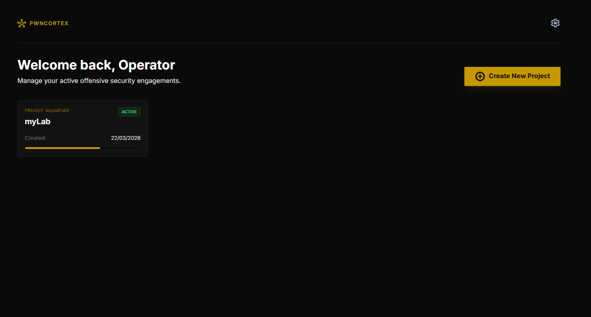
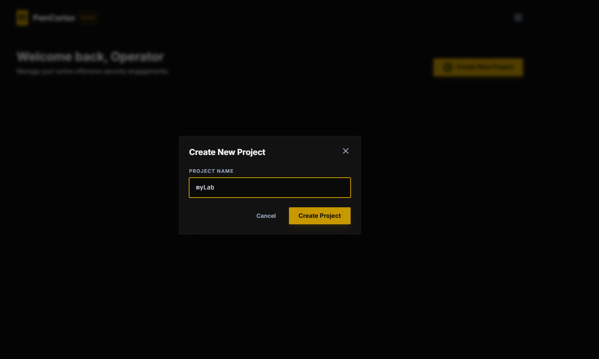
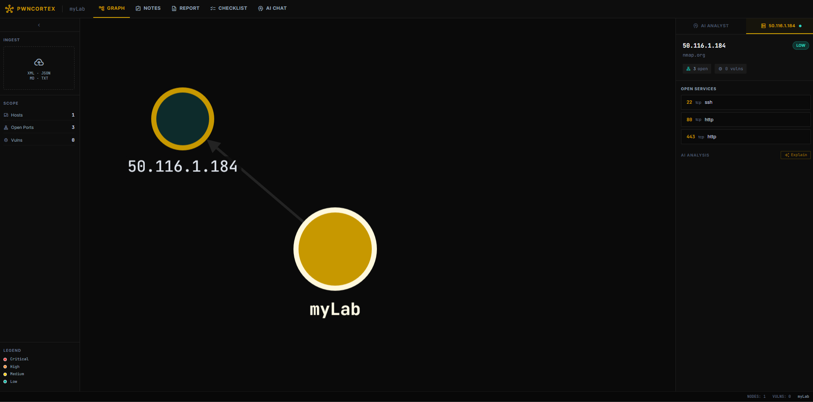
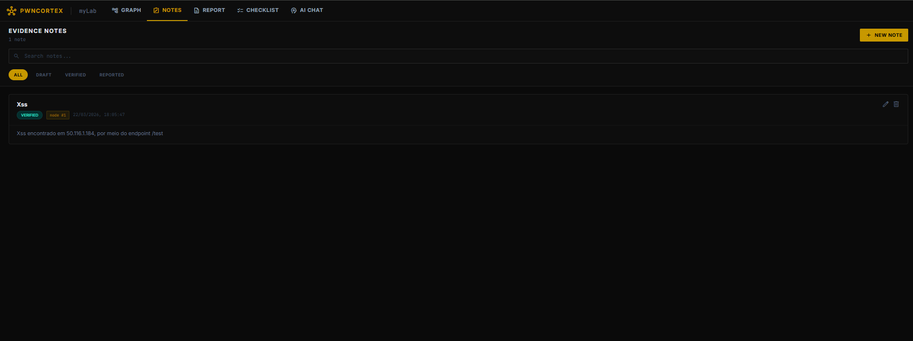
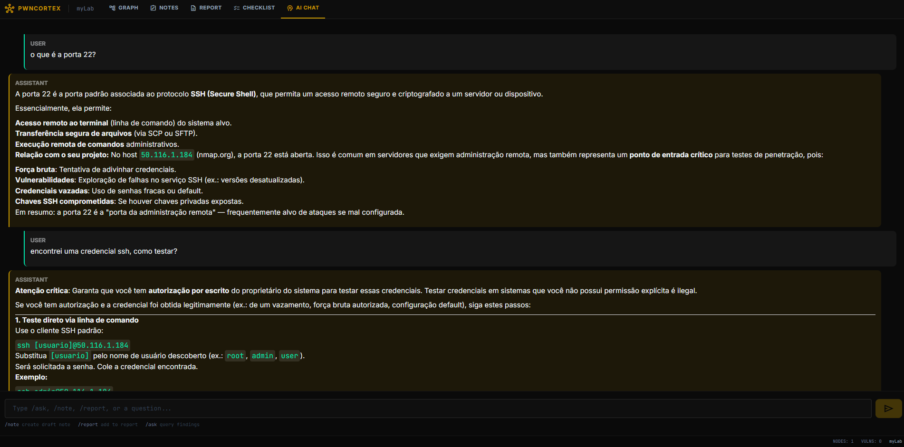
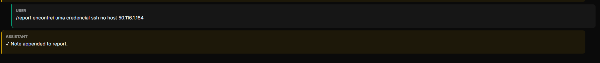
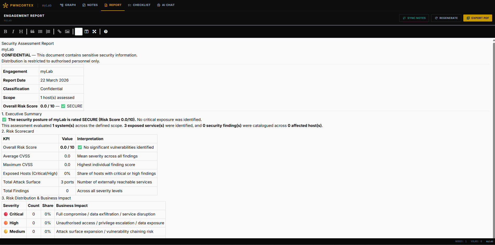
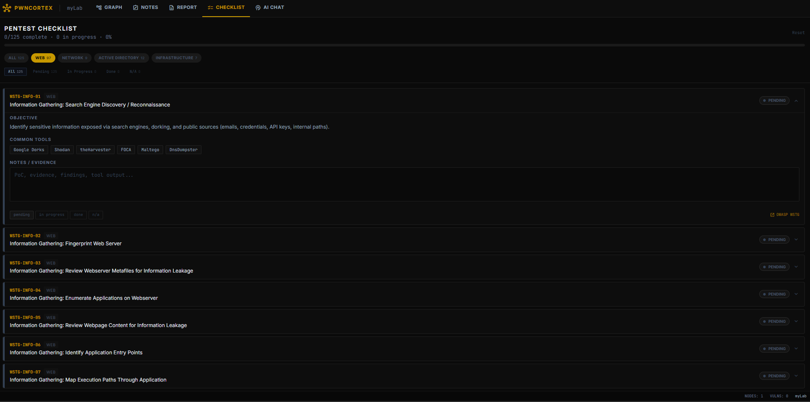
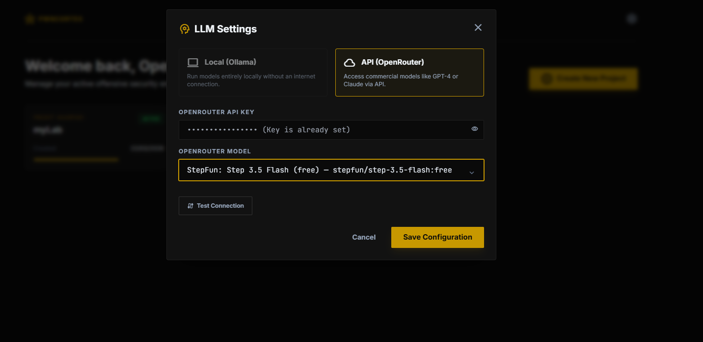

<div align="center">
  
  <h1>PwnCortex</h1>
  <p><strong>Pentest productivity platform with AI, 100% self-hosted.</strong></p>
  <p>
    <a href="LICENSE"></a>
  </p>
</div>

## What PwnCortex is

PwnCortex was built for a real problem of the modern pentester: **keeping all the intelligence of an engagement in one place, with context-aware AI built in**. Instead of loose spreadsheets and scattered tools, PwnCortex turns raw scans (Nmap XML, JSON, MD, TXT) into an interactive network topology, enriches each host automatically with NVD/CVE data, lets you ask questions in natural language to an LLM that knows the whole project, and produces an executive report with CVSS scoring, ready for the client. Everything runs locally, with no telemetry and no cloud.

---

## Features

- **Unified scan ingestion**: import Nmap XML, JSON, Markdown or plain text. Ports, services, CPE strings and NSE script output are parsed into structured records automatically.
- **Interactive network graph**: a Cytoscape.js topology built from the ingested scans. Select a node to see its ports, vulnerabilities and AI-generated explanations (cached per session).
- **Context-aware AI chat**: ask about the target in natural language. The LLM receives the full project context (nodes, ports, vulns, notes) with every message. Supports local Ollama and OpenRouter.
- **Evidence notes**: create, filter and search findings with a `Draft → Verified → Reported` lifecycle. Verified notes sync automatically into the executive report draft.
- **Automated executive report**: generates a confidential Markdown report with an executive summary, risk scorecard, remediation roadmap ranked by CVSS and a technical appendix. Exportable to PDF.
- **OWASP WSTG checklist**: 121 items across Web, Network, Active Directory and Infrastructure, with per-item status and visual progress.
- **Two LLM providers**: use local Ollama (default: `qwen2.5:3b`) for air-gapped engagements, or switch to any OpenRouter model from the interface at any time.
- **NVD/CVE enrichment**: vulnerabilities are enriched automatically with CVSS scores from the NVD API.
- **100% local**: no telemetry, no cloud dependency. All data stays in a SQLite database on your machine.

---

## Technical concepts

### Shared AI context
With every AI chat message, the LLM receives a *system prompt* built on the fly with every node, open port, vulnerability and note in the project. You never copy and paste data by hand, and the model always knows exactly what is in scope.

### Note lifecycle
Notes follow a `Draft → Verified → Reported` pipeline. When a note is marked `Verified` or `Reported`, a BackgroundTask syncs it into the project's `report_draft`, so the executive report always reflects the current state of the investigation.

### Automatic CVSS scoring
The executive report computes an **Overall Risk Score** per host as a normalized sum of squares of the CVSS scores. If a CVE has no score in the database, the system infers one from the severity (Critical→9.5, High→7.5, Medium→5.0, Low→2.5) and marks it as *(inferred)*.

### Per-node explanation cache
Each time the LLM explains a node (ports, services, recommendations), the explanation is stored in the database. The cache is invalidated automatically when new scan data or notes are added to the node, so the explanation stays current.

---

## Visual tour

PwnCortex has a dense, dark technical interface designed for long working sessions.

### 1. Dashboard: project management
Create and manage your engagements. Each project is isolated with its own UUID.

<div align="center">
  
  
</div>

*Left: active projects. Right: the new project dialog.*

---

### 2. Graph view: network topology
The visual core of the project. After you ingest a scan, the graph is built automatically. Click any node to see details, ports and vulnerabilities, and to ask the AI for an explanation.



*Interactive topology with a concentric layout. The right panel shows the selected node with its cached AI analysis.*

---

### 3. Evidence notes
Record and organize findings with Markdown, status filters and full-text search. Verified notes feed the report automatically.

<div align="center">
  
</div>

*Note list with status filters.*

---

### 4. AI chat: contextual analysis
Talk to the LLM about your target. Slash commands create notes and report entries straight from the chat.



*The assistant explains attack vectors, suggests next steps and keeps the whole project context in the conversation.*



*The `/report` command adding an analyst note to the executive report draft.*

---

### 5. Executive report
Generate a confidential Markdown report in executive and technical language. It includes a risk scorecard, a remediation roadmap by time window (0–48 h / 2 weeks / 30 days / 90 days) and a technical appendix with every finding.



---

### 6. OWASP WSTG checklist
121 security items organized by category, with individual status tracking and visual progress.



---

### 7. LLM settings
Switch between local Ollama and OpenRouter without restarting the stack. The API key is never exposed, only a `key_set` boolean.

<div align="center">
  
</div>

---

## Running it

### Requirements
- [Docker](https://docs.docker.com/get-docker/) installed and running.
- The Compose plugin (`docker compose version`).

### Install

```bash
# Clone the repository
git clone https://github.com/brennocm/pwncortex.git
cd pwncortex

# Copy and edit the .env
cp .env.example .env

# Start the stack (interactive: choose local Ollama or an API)
./start.sh
```

### Access

| Service | URL |
|---|---|
| Web interface | http://localhost:80 |
| API | http://localhost:8000 |
| Ollama | http://localhost:11434 |

### Development with hot reload

```bash
docker compose -f docker-compose.yml -f docker-compose.dev.yml up
# Frontend dev server: http://localhost:5173
```

> **Stop**: `./stop.sh` keeps volumes and the database.
> **Reset**: `./reset.sh` stops containers, removes images and rebuilds from scratch.

### Environment variables

| Variable | Description | Default |
|:---|:---|:---|
| `LLM_PROVIDER` | Active provider: `ollama` or `openrouter` | `ollama` |
| `OLLAMA_MODEL` | Ollama model to use | `qwen2.5:3b` |
| `OPENROUTER_API_KEY` | OpenRouter API key (optional) | — |
| `OPENROUTER_MODEL` | OpenRouter model to use | `anthropic/claude-3.5-haiku` |

> You can also change these at runtime from the **Settings** icon in the interface, without restarting the stack.

---

## Architecture

- **Backend** (`src/server`): Python 3.12, FastAPI, Uvicorn. BackgroundTasks for AI calls and heavy parsers.
- **Domain** (`src/domain`): LLM clients (Ollama + OpenRouter), Nmap parser, report generator, note sync.
- **Database** (`src/data`): SQLAlchemy 2.x + SQLite. UUID project IDs (prevents IDOR).
- **Frontend** (`src/web`): React 18, Vite, TailwindCSS 3, Cytoscape.js, EasyMDE.
- **Proxy**: Nginx, routing `/api` → FastAPI and `/` → React.

---

## Troubleshooting

**The stack does not start, or ports are taken?**
Check that ports `80`, `8000` and `11434` are free. Run `./reset.sh` to clean up containers and images.

**`404 No endpoints available` error on OpenRouter?**
Go to `openrouter.ai/settings/privacy` and relax the data guardrail policy.

**Ollama does not answer?**
Check that the service is healthy: `docker compose ps`. The `ollama` container uses the `local` profile; start it with `--profile local` or through `./start.sh`.

**Outdated node explanation?**
The explanation cache is invalidated automatically when you ingest new scans or add notes. If needed, delete the node and import the scan again.

---

## Legal notice

PwnCortex is intended **only for authorized security testing**. Using it against systems without explicit written permission is illegal. The authors are not responsible for misuse.

---

## License

This project is licensed under the **AGPL-3.0**. See [LICENSE](LICENSE) for details.
